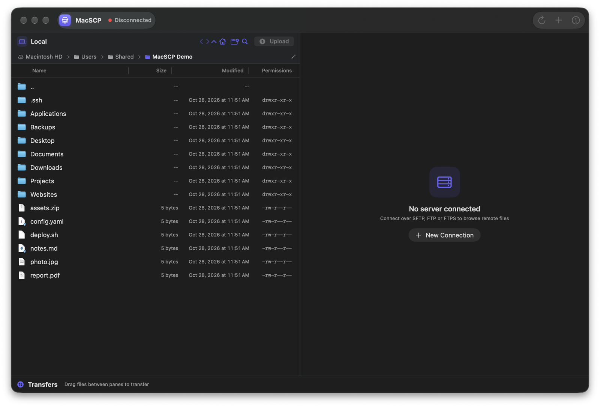
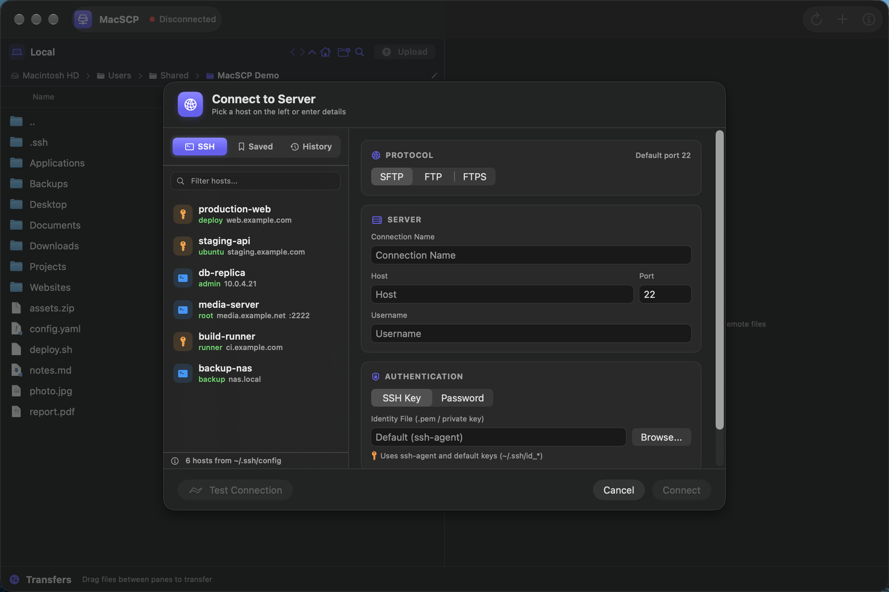
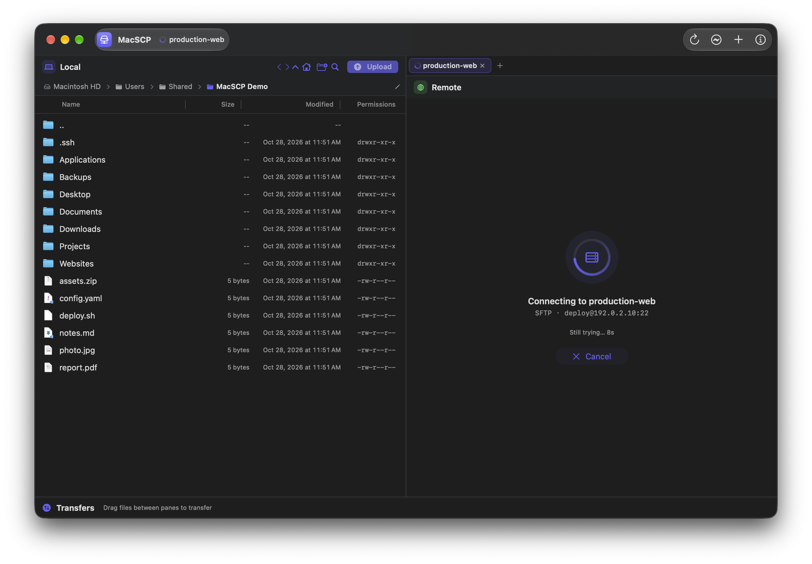

# MacSCP

A native macOS SFTP/FTP client built with SwiftUI. Dual-pane file manager inspired by WinSCP — browse local and remote files side by side, transfer with drag-and-drop, and manage files on your servers.

  

## What's new in 1.1

- **Premium redesign** — unified title bar, real Finder file icons, clickable breadcrumb paths, hover highlights, glowing drop targets and a new indigo accent
- **Faster connecting** — SFTP connects in a single round trip and skips slow GSSAPI auth probes
- **Cancel anytime** — a live "Connecting…" screen with elapsed time and a Cancel button (`Esc`)
- **FTP & FTPS** — alongside SFTP
- **Redesigned Connect dialog** — pick hosts straight from `~/.ssh/config`, saved connections or history

## Features

- **Dual-Pane Browser** — Local files on the left, remote files on the right, with clickable breadcrumb paths
- **SFTP, FTP & FTPS** — One app for all three protocols
- **SSH Config Import** — Every host in `~/.ssh/config` is ready to connect, including identity files and ports
- **Connection Manager** — Save, reorder and reconnect from history
- **SSH Key & Password Auth** — Uses ssh-agent keys, `.pem` files, or a password
- **Tabs** — Connect to several servers at once
- **File Transfers** — Upload and download with progress bars, speed and ETA
- **File Operations** — New folder, rename, delete, copy, chmod, compress and extract on the server
- **Remote Editing** — Open text files from the server, edit them and save them back
- **Drag & Drop** — Drag files between panes or from Finder into the remote pane
- **Keyboard Shortcuts** — `⌘K` connect, `⌘R` refresh, `⌘U` upload, `⌘D` download, `⌘C` / `⌘V` copy & paste files

## Screenshots

**Connect to Server** — hosts from `~/.ssh/config`, saved connections and history

**Connecting** — live progress with a Cancel button

## Requirements

- macOS 13.0 (Ventura) or later
- SSH client (`/usr/bin/ssh`, `/usr/bin/scp`) — included with macOS

No third-party dependencies. Uses the system SSH/SCP binaries.

## Install

### From DMG

Download the latest `.dmg` from [Releases](https://github.com/eshad/macscp/releases), open it, and drag **MacSCP** to **Applications**.

> MacSCP is not notarized yet. The first time you open it, right-click the app and choose **Open**.

## License

MIT
